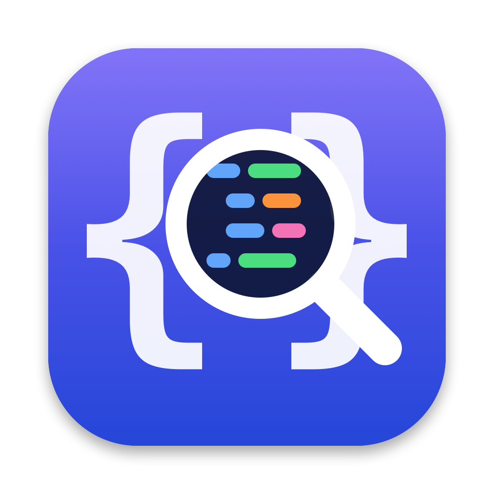
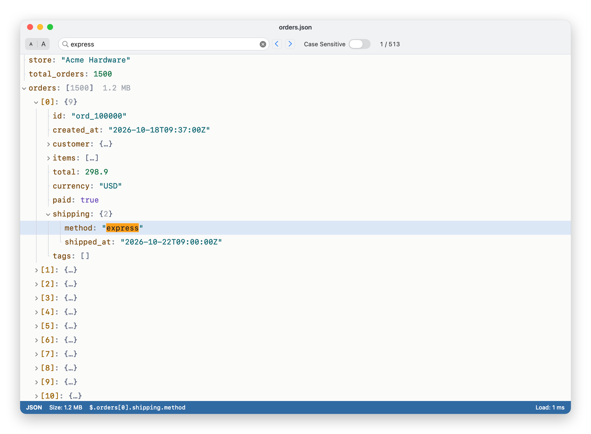

<div align="center">



# Loupe

**A fast, native JSON viewer for macOS that opens gigabyte-sized files in about a second.**

[](https://github.com/Keremtspnr/loupe-json/releases/latest)
[](https://github.com/Keremtspnr/loupe-json/actions/workflows/ci.yml)


[](LICENSE)

<picture>
  <source media="(prefers-color-scheme: dark)" srcset="docs/screenshot-dark.png">
  
</picture>

</div>

Most JSON viewers parse the whole document into objects before showing anything, so
a 1 GB file means several gigabytes of RAM, a spinning cursor, and often a crash.
Loupe never builds a document tree. It keeps the file as one byte buffer and only
looks at the part of the tree you actually open.

## Features

- **Huge files**: opens a 1.1 GB, 4.3-million-item file in about a second and stays responsive while doing it
- **JSON, NDJSON and JSON Lines**: `.json`, `.ndjson` and `.jsonl`, with each line of a stream shown as a top-level item
- **Fast search**: searches the raw file in the background, jumps straight to each match and highlights it in place
- **Readable tree**: syntax colors, tree guide lines, and item counts and sizes for every object and array
- **Light and dark themes**: follows macOS, or pick one under *View → Appearance*
- **Adjustable text size**: ⌘+ / ⌘− / ⌘0, remembered between launches
- **Copy anything**: a value, a key, or its JSONPath (`$.orders[42].customer.email`)
- **Forgiving parser**: single quotes, unquoted keys, trailing commas and truncated files open without crashing
- **Native and small**: Swift and AppKit, a single universal binary for Apple silicon and Intel, no Electron

## Install

1. Download **Loupe-x.y.z-macOS.zip** from the [latest release](https://github.com/Keremtspnr/loupe-json/releases/latest).
2. Unzip it and drag **Loupe.app** to your **Applications** folder.
3. The first time, **right-click Loupe.app → Open** and confirm. Loupe isn't notarized by Apple yet, so macOS asks once.

If macOS still refuses to open it:

```bash
xattr -dr com.apple.quarantine /Applications/Loupe.app
```

To make Loupe the default app for JSON files, select any `.json` file in Finder,
choose **File → Get Info → Open with → Loupe**, then click **Change All…**.

## Usage

Open a file with ⌘O, drop it on the window, or paste JSON from the clipboard with ⇧⌘V.

| Action | Shortcut |
|---|---|
| Open file / open from clipboard | ⌘O / ⇧⌘V |
| Reload file | ⌘R |
| Find / next match / previous match | ⌘F / ⌘G / ⇧⌘G |
| Copy value / key / JSONPath | ⌘C / ⌥⌘C / ⇧⌘C |
| Bigger / smaller / default text | ⌘+ / ⌘− / ⌘0 |
| Expand selection / collapse all | ⌥⌘→ / ⌥⌘← |
| Expand or collapse a row | → / ← or double-click |

## Performance

Measured on an Apple M4 with release builds, on a generated 1.1 GB file with 4.3 million objects:

| Step | JSON | NDJSON |
|---|---|---|
| Read file | 0.59 s | 0.34 s |
| Scan top level | 0.92 s | 0.70 s |
| Open a 4.3-million-item array | 0.64 s | — |
| Full-text search (case-sensitive / -insensitive) | 0.32 s / 0.23 s | 0.18 s / 0.22 s |
| Jump to a match | < 1 ms | < 1 ms |

Run it yourself:

```bash
swift build -c release
.build/release/loupe-bench gen /tmp/big.json 1024
.build/release/loupe-bench run /tmp/big.json
```

## How it works

```
file ──► one byte buffer ──► lazy, one-level scan ──► 32-byte records ──► NSOutlineView
                    └──────► background raw-byte search ──► offset ──► binary search to node
```

- **No DOM.** Each child of an object or array is a 32-byte record holding offsets into the buffer:
  where its key and value start and how long they are. Text is sliced from the buffer only when a row is drawn.
- **One level at a time.** Opening a node scans only its direct children. Nested values are
  skipped by matching brackets and strings, never parsed.
- **Huge arrays are grouped** into ranges of 10,000 (`[0 … 9999]`), so the list view never has to handle millions of rows.
- **Search runs on the raw bytes.** A match offset is mapped back to the tree with a binary search per level,
  scanning only the levels on the way to it.
- **The UI never blocks.** Reading, large scans and searches run in the background with progress and cancel.

The engine lives in [`Sources/JsonCore`](Sources/JsonCore) and has no UI dependencies; the app is in [`Sources/Loupe`](Sources/Loupe).

## Build from source

Requires macOS 15 and Xcode 16 or later.

```bash
git clone https://github.com/Keremtspnr/loupe-json.git
cd loupe-json
swift test                  # run the test suite
./scripts/build-app.sh      # build build/Loupe.app
open build/Loupe.app
```

`./scripts/install.sh` builds Loupe, copies it to `/Applications` and makes it the default app for
`.json`, `.ndjson` and `.jsonl`. `./scripts/release.sh` packages a universal zip into `dist/`.

Sample files to try are in [`examples/`](examples).

## Roadmap

- [ ] Regex and JSONPath queries
- [ ] Unicode-aware case-insensitive search
- [ ] Export a node as formatted / minified JSON, CSV
- [ ] Minimap for long documents
- [ ] Reload automatically when the file changes
- [ ] Memory-mapped files larger than RAM
- [ ] Notarized builds and a Homebrew cask

Ideas and bug reports are welcome in [Issues](https://github.com/Keremtspnr/loupe-json/issues).

## Contributing

Pull requests are welcome. See [CONTRIBUTING.md](CONTRIBUTING.md) for how to build, test and submit changes.

## License

[MIT](LICENSE) © 2026 Kerem Taşpınar
